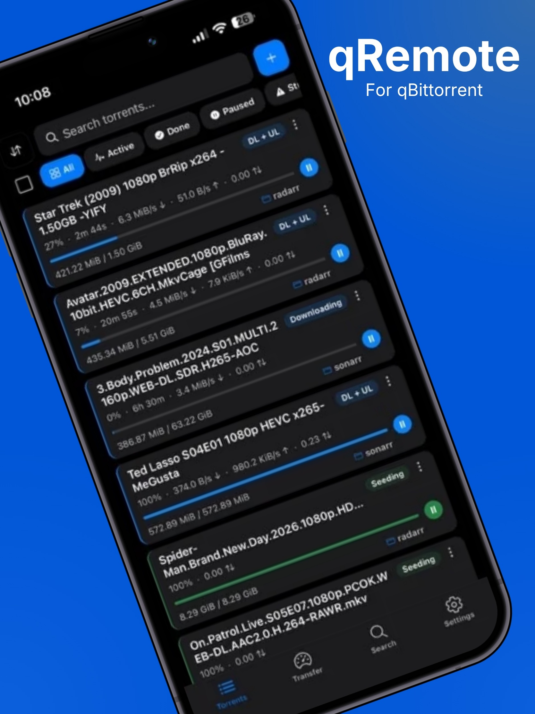
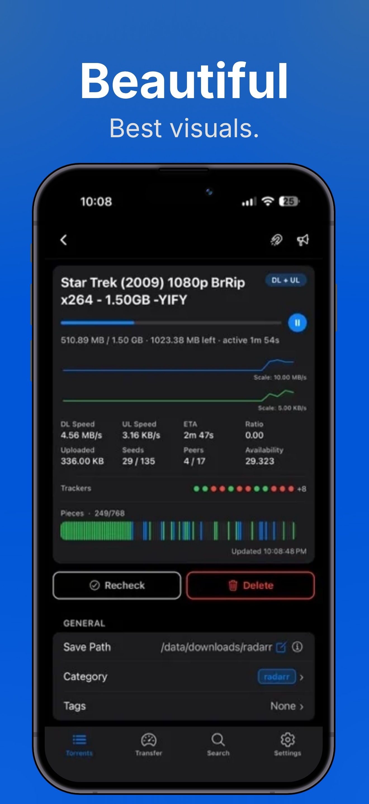
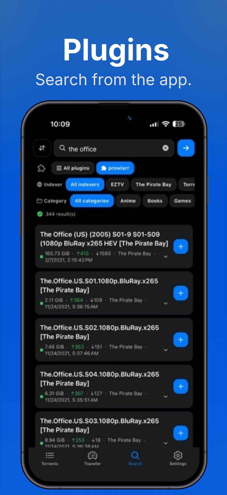
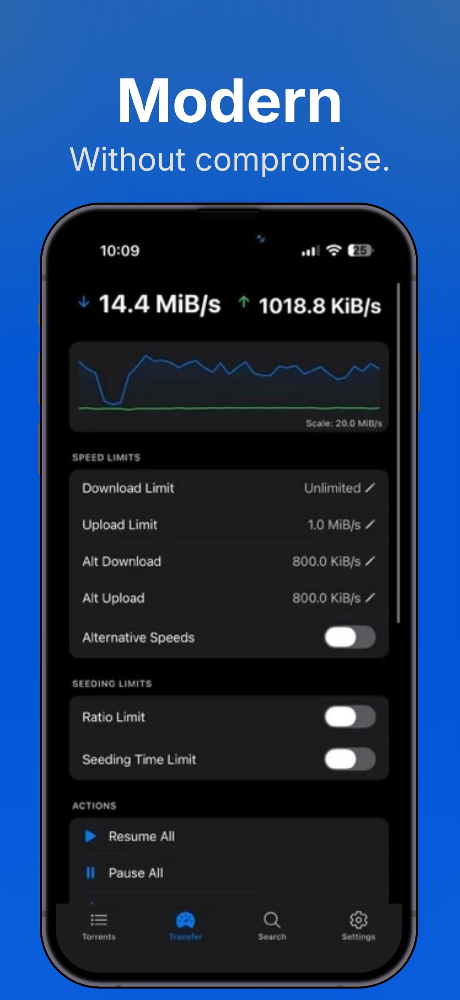
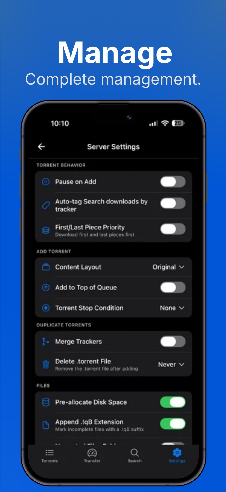

# qRemote

[](https://apps.apple.com/app/qremote-for-qbittorrent/id6756276747)
[](https://testflight.apple.com/join/ZHp9Uq4h)
[](https://github.com/taylorcox75/qRemote/actions/workflows/coverage.yml)

An iPhone and iPad app for controlling qBittorrent. It talks to the WebUI API your server already has, so there is nothing extra to install on the server side.

Free, open source, no ads, no account, no tracking. The app only ever talks to the servers you add.

<p align="center">
  
  
  
</p>

## Install

Get it from the [App Store](https://apps.apple.com/app/qremote-for-qbittorrent/id6756276747). If you want new builds early and don't mind the occasional bug, join the [TestFlight beta](https://testflight.apple.com/join/ZHp9Uq4h).

You need qBittorrent 4.1 or newer with the Web UI turned on (Tools → Options → Web UI). A few features need qBittorrent 5.x; the app hides them on older servers instead of failing.

## Connecting

Open Settings → Servers → **+**, then enter the host, port and login you use for the Web UI in a browser. Use **Test Connection** before saving if you're not sure about the details.

Some setups need a bit more, and these are all on the same screen:

- HTTPS, including self-signed certificates (opt-in per server)
- Basic Auth or custom HTTP headers, for a reverse proxy or something like Cloudflare Access in front of qBittorrent
- API key login, or no login at all if your server allows it for your network
- A [qui](https://getqui.com) Client Proxy URL
- A fallback address, so the same server works at home and away

Passwords, API keys and header values go in the iOS Keychain. You can add as many servers as you like and switch between them from the top of the torrent list. The server list can be exported and imported, and exports never contain secrets.

## What it does

**Torrents.** The list updates every couple of seconds. Filter by state, category or tag, sort it, search it, swipe a row for quick actions, or select several and act on them together. Add a magnet link or a `.torrent` file from inside the app, from the share sheet, or by opening the file in Files.

**Details.** Everything qBittorrent knows about a torrent on one screen: trackers, peers, files with per-file priority, the piece map, speed and share limits, save path, category and tags. Most of it can be edited in place.

**Search.** Uses the search plugins installed on your server, including Jackett and Prowlarr. Results can be sorted by relevance, seeders, size or video quality, filtered by resolution, codec and source, and duplicates of the same release across indexers are collapsed into one row. Add a result with one tap, or queue up several and add them together. Plugins can be installed and removed from the app.

**Transfer.** A live speed graph, session and all-time totals, global and alternative speed limits, and global ratio and seeding-time limits.

**RSS.** Feeds, folders and auto-download rules. The tab appears when RSS is enabled on the server.

**Server settings.** The qBittorrent options you would actually want to change from a phone: save paths, listen port, connection limits, proxy, IP filtering, plus a viewer for the server's log.

<p align="center">
  
  
</p>

A few other things:

- Light and dark mode, a handful of theme presets, and a color picker for every color in the app if none of them suit you
- Split view on iPad and other wide screens
- English, Spanish, Chinese, French, German, Russian, Polish, Turkish and Italian

## Problems and requests

Please [open an issue](https://github.com/taylorcox75/qRemote/issues). For connection problems, Settings → Advanced → View Connectivity Logs has a copy button, and pasting that log into the issue usually saves a round of questions. Check it for anything you'd rather not post first.

Mention your qBittorrent version and whether a reverse proxy sits in front of it.

## Building from source

You need a Mac with Xcode and Node.

```bash
git clone https://github.com/taylorcox75/qRemote.git
cd qRemote
npm run xcode
```

That installs dependencies, generates the `ios/` project and opens it in Xcode. Pick a simulator or your device and press Run. For fast refresh while you work, run `npm start` alongside it.

The app has custom native code, so it won't run in Expo Go. `ios/` is generated and not committed; native configuration lives in `app.config.js`.

```bash
npm test          # Jest
npx tsc --noEmit  # type check
npm run lint
```

## Contributing

Pull requests are welcome. Branch from `main` and open the PR against `main`. [AGENTS.md](AGENTS.md) is the map of the codebase and its conventions; it is written for coding agents but is just as useful to people.

Two things to know up front: every user-facing string needs a translation in all nine locale files (a test checks this), and anything that changes stored settings has to keep working for people who already have the app installed.

Translation fixes from native speakers are especially appreciated.

## Support

qRemote is a side project. If it's useful to you, an [App Store rating](https://apps.apple.com/app/qremote-for-qbittorrent/id6756276747) helps more than anything, and there's a [beer fund](https://www.paypal.com/donate/?business=E9XLGFHN963HN&no_recurring=0&currency_code=USD) if you're feeling generous.

## License

MIT
